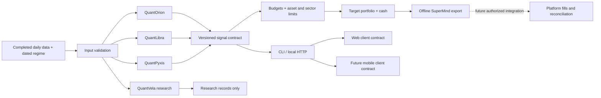

# Architecture / 架构

本次按商业计划书分层。可运行路径为JSON输入→校验→纯规则→统一信号→预算与集中度检查→目标导出。没有自动交易链路，也没有把目标仓位伪装成成交持仓。

| 层 | 实现 | 边界 |
| --- | --- | --- |
| 数据 | data/validation.py | 资产命名、日期升序、重复/缺值拒绝、同交易日期对齐 |
| 研究 | models/quantvela | 基于研究说明的新规则函数；历史账户引擎未提供 |
| 模型 | models/quantorion、quantlibra、quantpyxis | 无网络、副作用和凭据；输入到输出可测试 |
| 组合 | portfolio/allocation.py | 明确预算；重复资产相加；不通过限额即拒绝，不暗改策略 |
| 平台 | adapters/supermind.py | 可审阅的目标JSON，can_submit_orders=false |
| 终端 | interfaces | CLI和本地HTTP共用engine.evaluate；生产Web/App需后续建设 |
| 原工程 | prototypes、research | 保留旧依赖、完整平台事件回调和研究轮次，隔离导入 |

## 设计选择

采用单仓库而非将原工程直接拼成一个服务：原来两套Web、不同平台API和历史引擎不能共用一个任意依赖环境。新核心零运行依赖，旧项目保留独立入口。纯规则提取与原型搬迁分别记录，代码品牌统一不代表所有历史版本已验证等价。

统一接口用 completed signal_date 和 execute_after，而不自行将“明天”当作交易日。日期相同或资产日线不对齐时拒绝。冻结市场状态过期显式expired；数据不足为invalid_data；正常空仓为no_candidates且cash_weight=1。失败状态的cash_weight=null。

## 后续工程顺序

接入真实授权数据与交易日历→冻结三模型参数与前向记录→逐模型SuperMind原生迁移→组合日志和成交回读→统一生产Web→移动端。研究快照不能跳过这些环节成为自动交易系统。
