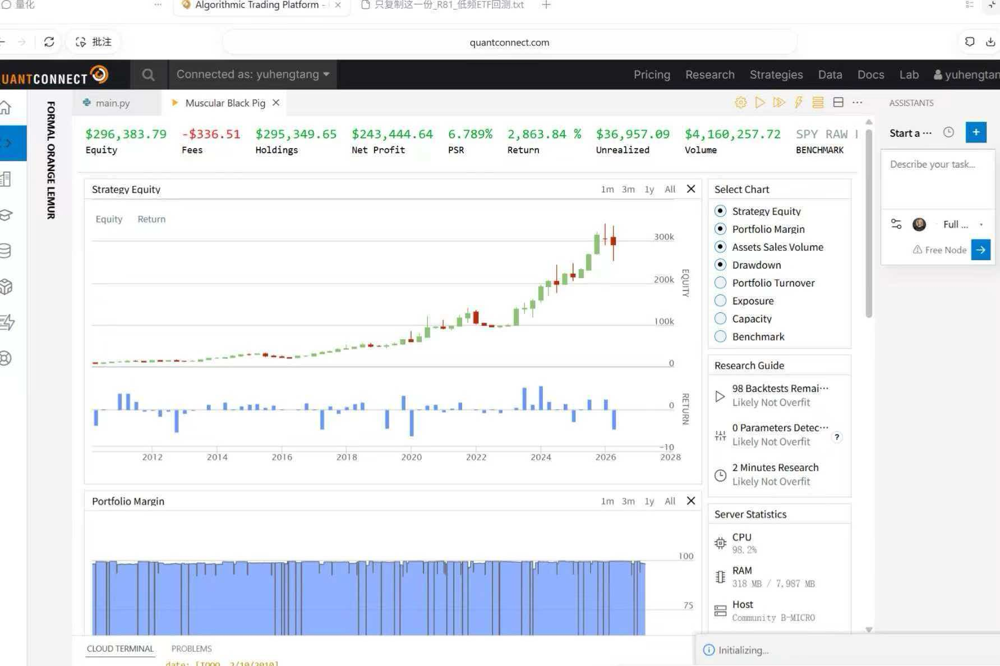
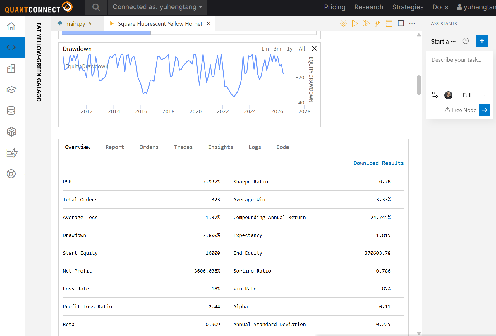
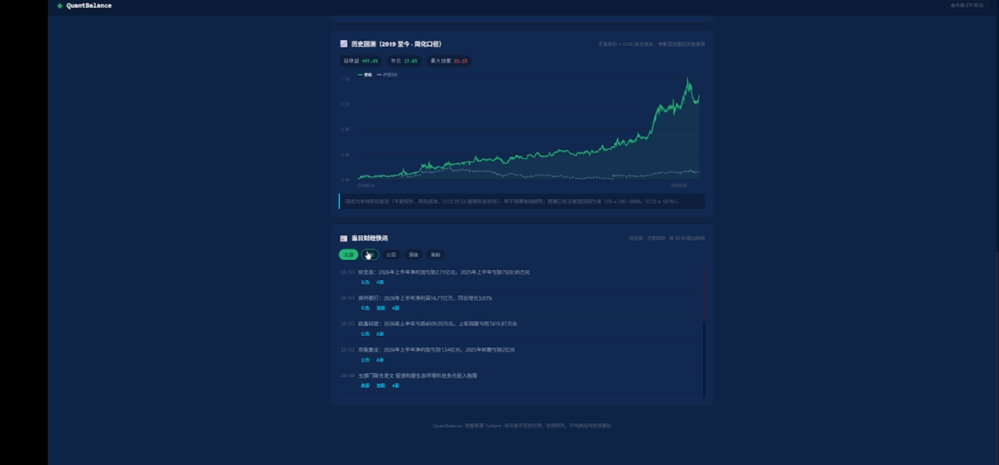
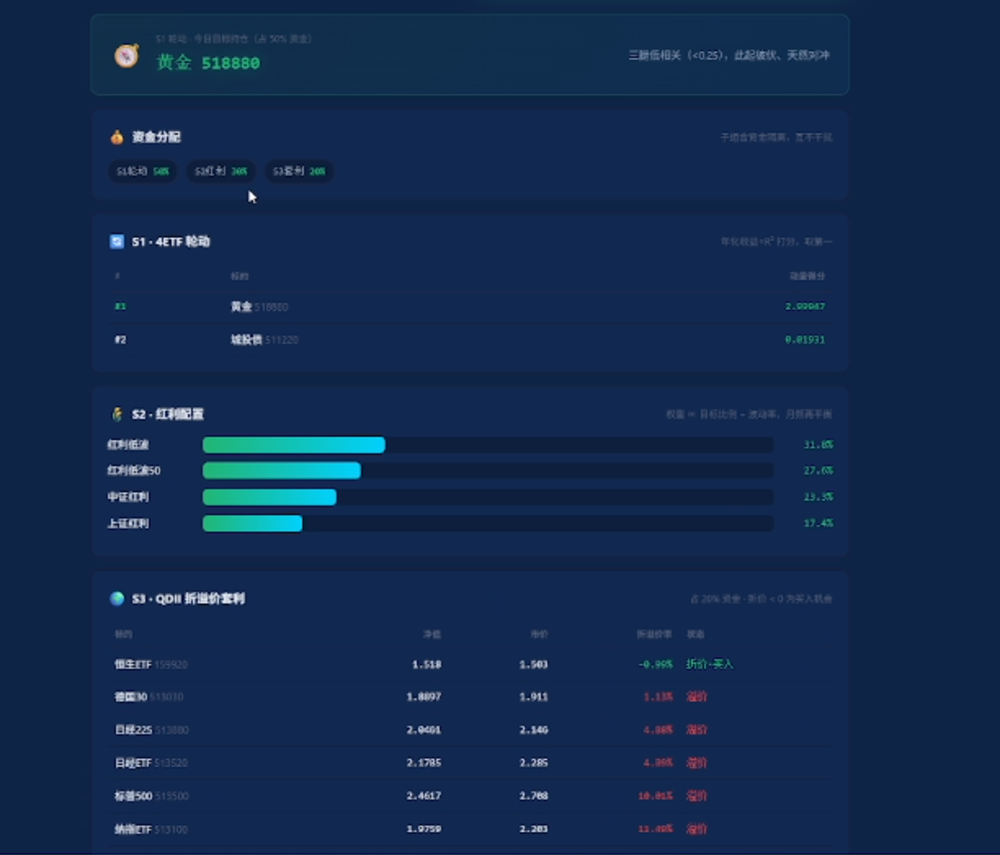
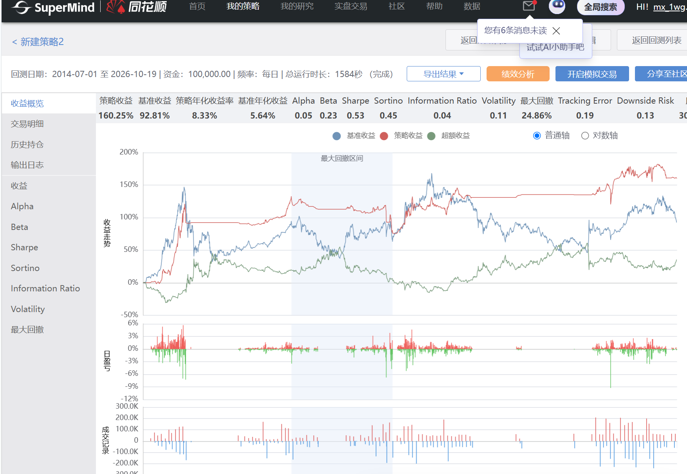
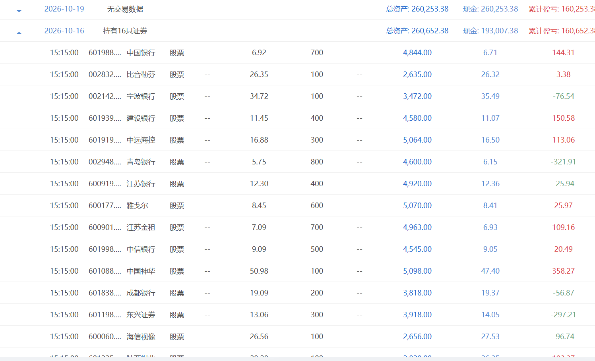

# QuantScope — Company Overview and Business Plan

English edition · 量见 QuantScope

## 01 Company overview

QuantScope is an early-stage AI financial technology and quantitative research venture. Its identity draws on a telescope: observing complex markets, forming measurable hypotheses and checking them through repeatable research. The Chinese company brand is 量见; legal registration remains subject to the actual incorporation process.

The company combines one research project with three proprietary model development tracks. QuantVela (量寰, Vela) studies global asset allocation and US ETF strategies. QuantOrion (量曜, Orion) studies short-horizon A-share market structure. QuantLibra (量衡, Libra) studies ETF rotation, multi-asset allocation and backtest checks. QuantPyxis (量枢, Pyxis) studies medium-term A-share momentum and regime-dependent exposure.

The operating sequence is to validate a company-owned capital allocation approach first, then develop reusable software and paid technical services after the tools and operating records are sufficiently mature. These are development goals; neither stable profits nor an existing customer base is asserted.

Current assets include research rules, experimental reports, Web prototypes, static checking tools, local backtest implementations and historical platform backtest versions. Their levels of completeness differ. A unified production platform, mobile application and three-model live execution system remain engineering milestones.

## 02 Research and model collaboration

QuantVela provides the research track: cross-market comparisons, US index and leveraged-ETF studies, trend-state analysis and account-level assumptions. At present it performs research, historical testing and simulation rather than live execution.

The three operating model candidates have different responsibilities. QuantOrion translates consecutive-limit-up and volume-contraction patterns into inspectable conditions. QuantLibra ranks ETF momentum and manages rotation decisions. QuantPyxis combines cross-sectional stock selection, liquidity requirements and market-state exposure budgets. Using the three together is an intended company process, not a claim that diversification or low correlation has already been demonstrated.

The planned portfolio relationship is w_j = Σ_m α_m × w_mj, where α_m ≥ 0 and Σ_m α_m ≤ 1. Here α is each model's capital budget, while w_mj is its target weight for an asset. Unallocated capital remains cash. A company-level layer must check overlapping exposure, conflicting orders, concentration, available funds and data dates.

The formula is an architectural target. It does not establish an optimized allocation or a verified combined performance record. Model errors, missing data and valid cash positions must remain distinguishable.

## 03 QuantVela — global allocation research

QuantVela is an AI financial technology R&D project with a long-term global allocation remit. Its current studies emphasize US index ETFs, leveraged ETFs, trend states and cross-market comparison. Vela refers to the constellation of the sails, reflecting a broad research horizon.

Its daily three-state branch uses a completed QQQ close P and 50-day and 200-day simple moving averages. When P > MA200 and MA50 > MA200, the research target is 100% TQQQ. When both are below MA200, it is 50% QQQ and 50% cash. All other cases use 100% QQQ. Execution is considered only after the completed signal session.

```python
if close > ma200 and ma50 > ma200:
    target = {"TQQQ": 1.0}
elif close < ma200 and ma50 < ma200:
    target = {"QQQ": 0.5, "CASH": 0.5}
else:
    target = {"QQQ": 1.0}
```

This excerpt illustrates the rules; it is not presented as an original historical backtest engine.

A separate monthly research branch estimates σ63 = sd(63 daily returns) × √252. If QQQ is above MA200, target index exposure L = min(2.5, 0.35 / σ63); otherwise it holds cash. ETF weights interpolate between QQQ, QLD and TQQQ. The 35% target and 2.5 cap are fixed research assumptions, not proven optimal choices. Daily and monthly branches must not have their rules or track records merged.

Research value lies in comparable benchmarks, retained negative experiments and realistic account reconciliation. NAV includes cash plus positions marked to prices; whole-share rounding, settlement, dividends and withholding require separate treatment. AI assists information organization, experiment design and explanations; traceable programs remain responsible for return calculations. Uncovered markets and any predictive AI contribution require additional validation.

## 04 QuantVela — research examples



Historical QuantConnect research interface. The displayed project, observation period and assumptions belong to that individual experiment.



A separate historical research example. These screenshots are not one continuous track record, do not establish live company results and should not be combined into a single return claim.

The next research milestone is a frozen specification, reconciled account records, reproducible runs under the same assumptions and forward observation. Historical exploratory samples are not clean out-of-sample evidence merely because they cover a long period.

## 05 QuantOrion — A-share market structure

QuantOrion combines daily rule screening, market information organization and AI-assisted explanation. Orion refers to the constellation of the hunter; 量曜 evokes observation and illumination. A Web interface and program prototype exist, while company-level portfolio integration remains incomplete.

The baseline identifies two consecutive daily limit-up conditions together with contracting volume. Define L_i,t = 1[r_i,t ≥ 0.995 × U_i], where returns and rule-based limit percentages use the same units. The signal is S_i,t = A_i × L_i,t × L_i,t−1 × 1[V_i,t < V_i,t−1]. A_i denotes the intended A-share universe. The 0.995 tolerance is an approximation and still requires checks against actual exchange limits and executable prices.

```python
merged["lt"] = merged.apply(lambda r: is_limit(r, "pct_chg"), axis=1)
merged["ly"] = merged.apply(lambda r: is_limit(r, "pct_chg_y"), axis=1)
merged["vd"] = merged["vol"] < merged["vol_y"]
hits = merged[merged["lt"] & merged["ly"] & merged["vd"] & merged["is_a"]]
hits = hits.sort_values("vol", ascending=True)
```

This is a prototype source excerpt with explanatory comments omitted. A separate experiment tightens volume contraction to 0.7 times the previous day's volume; it is a different parameter version.

The logic is inspectable and suitable for tracing why an asset was selected. Data, rules, AI explanation and presentation can be separated for migration. AI is not a substitute for the screening rules or a verified predictor of returns.

The prototype's prior-close purchase assumption requires correction. Limit-up buying, limit-down selling, costs, slippage and capacity require execution modeling. Its lot-size expression q_i = 100 × floor[B_i / (100 × P_i)] describes budget rounding only; it does not reserve transaction fees or prove that P_i is attainable.

## 06 QuantOrion — product and demonstration


Historical system demonstration. Formerly AlphaBoard. Displayed historical numbers are not company live trading performance.


Historical exhibition display, retained to show the earlier product form.

The engineering path is: prepare completed daily data and verify dates; screen and explain candidate signals; review costs and executability; adapt to the platform and conduct forward simulation with logs. The existing interface and rules provide a development foundation. Timing, logging and execution constraints must be completed before company-level risk and capital allocation integration.

## 07 QuantLibra — ETF rotation and allocation

QuantLibra focuses on ETF rotation, multi-asset research and backtest checks. Libra refers to the scales, reflecting a balance between return and risk. The current dual-momentum module studies dividend equities, ChiNext, Nasdaq exposure and gold ETFs.

Normalize prices as y_k = P_k / P_0. Slope momentum is M_slope = β̂ × R², where β̂ is the ordinary least-squares time slope and R² measures linear fit. For efficiency momentum, R = P_end / P_0 − 1 and D = Σ|P_k / P_k−1 − 1|; M_eff = R × |R| / D, returning zero when D is too small.

```python
def calc_eff_momentum(closes):
    ret = closes[-1] / closes[0] - 1.0
    daily = [(closes[i] / closes[i - 1] - 1.0) for i in range(1, len(closes))]
    path = sum(abs(d) for d in daily)
    if path < 1e-12:
        return 0.0
    return ret * (abs(ret) / path)
```

This preserves the existing function's calculation, with its explanatory docstring omitted. It is not a complete trading program.

Both momentum measures are ranked from high to low. Composite rank C = 0.5 × slope rank + 0.5 × efficiency rank; the smallest C is preferred. Non-positive efficiency momentum for the best candidate leads to cash. Otherwise, the current position, a 14-calendar-day cooldown and a rank threshold of three determine whether to rotate.

The original local signal loader uses 26 price observations, while the platform strategy uses 25. These variants must remain explicit. Parameters are research settings rather than proven optima. Different ETF labels do not automatically establish low portfolio correlation.

## 08 QuantLibra — workspace and checking tools



Research workspace with historical backtest display and financial information. Formerly QuantBalance. Signal dates, cost assumptions and displayed returns still require reconciliation.



Earlier capital allocation and strategy module interface.

The static checking tool addresses nine categories: survivorship and historical universes; limit-price fills; liquidity assumptions; future information; costs and slippage; excessive parameters; experiment toggles; missing out-of-sample records; and benchmark suitability.

The workflow is strategy text → rule scan → issue location and explanation → human review → modification and rerun. A finding means that review is required; an absence of findings does not certify a backtest. The LLM report layer assists explanation and provides neither statutory assurance nor return certification.

The QDII premium/discount research module requires matched NAV and market prices. An equal-weight holding approximation must not be represented as realized arbitrage performance.

## 09 QuantPyxis — momentum and regime exposure

QuantPyxis combines medium-term A-share momentum, liquidity filters and market-state capital budgets. Pyxis refers to the mariner's compass; 量枢 reflects a decision hub for selection and allocation.

For adjusted closes x, m12 = x[−22]/x[−253] − 1 and m6 = x[−22]/x[−127] − 1. Annualized volatility σ is the sample standard deviation of the latest 61 daily returns multiplied by √252. The frozen-A score is 0.5 × PctRank(m12/σ) + 0.3 × PctRank(m6) + 0.2 × PctRank(1/σ). These 50/30/20 coefficients are factor-score weights, not capital allocations.

```python
score=.5*df.ras.rank(pct=True)+.3*df.m6.rank(pct=True)+.2*df.inv.rank(pct=True)
score=score[df.ok]
candidates=sorted(score.dropna().index,key=lambda s:(-float(score[s]),s))
```

This is the frozen-A base scoring branch. Original variable names are retained. Ranking occurs before the eligibility mask; other experiments are separate versions.

Eligibility includes an unadjusted price of at least RMB 2, average 60-day turnover of at least RMB 200 million, adjusted close > MA60 > MA120 and annualized volatility no greater than 55%. The model forms a monthly target of up to 15 stocks, with a top-20 retention buffer for existing holdings. Lot affordability and blocked exits can affect actual positions.

Research exposure budgets are 100% in state B, 30% in N and zero in E/C. Daily exit checks do not mean immediate completed rebalancing. These two source lines show the exposure and final target output, with intervening selection logic omitted:

```python
exposure=BULL_BUDGET if state=='B' else .30 if state=='N' else 0.
weights={s:exposure/len(selected) for s in selected}
```

## 10 QuantPyxis — historical platform validation



Historical SuperMind backtest interface. Results belong to the displayed frozen version and its platform assumptions; they are not company live results.



Historical platform holdings view. Actual holdings may differ from an ideal target because of suspended assets, price limits, lot sizes or incomplete exits.

A platform backtest version exists, but local and platform results are not assumed identical. Reconciliation still needs aligned universes, prices, charges, orders, fills and daily positions. The frozen regime sequence ends on 19 October 2026 and cannot be extrapolated into current market states. Subsequent forward operation requires a maintained and validated state source.

## 11 Unified platform and terminal roadmap

The intended common integration target for QuantOrion, QuantLibra and QuantPyxis is SuperMind. QuantPyxis has historical platform backtest code; QuantOrion and QuantLibra require further migration from their prototypes. QuantLibra's existing platform code uses JoinQuant APIs and must not be described as a completed SuperMind implementation.

The architecture consists of five layers: data and research; versioned model signals; portfolio allocation and risk; platform execution and reconciliation; and shared Web/mobile terminals. Common signal fields include dates, model version, target holdings, weights, risk state, explanation and explicit failure states. A data error cannot be silently treated as a valid cash instruction.

The sequence is to stabilize research interfaces and Web workflows before extending the mobile terminal. Remote orders require authorized interfaces, account permissions and security validation. Integration targets do not imply an established commercial partnership with the platform provider.

The procurement budget assumes one SuperMind license at RMB 30,000 per year. Seats, accounts, model concurrency, compute, APIs, mobile use, data display and commercial rights depend on the actual contract. The plan does not assume that one license covers every use or that the platform directly supports US live trading.

## 12 Business model and operating sequence

Stage one is research and phased deployment using funds lawfully owned by the company. The three operating models support a shared capital allocation process. Investment gains depend on markets and actual implementation; losses are possible, and neither principal protection nor a fixed return is promised. QuantVela remains an R&D project at this stage.

Operating priorities are net performance after costs, drawdown, capital availability and system reliability. Simultaneous use of multiple models does not require full investment at all times. The company intends to retain cash budgets, exposure limits and pause mechanisms, with principal and operating reserves tracked separately.

Stage two turns stable internal capabilities into tools: research, backtests, reports, visualization and risk monitoring. The transition depends on validation and delivery maturity rather than an assumed month in which profits become stable.

Stage three explores paid software licenses and subscriptions, deployment and technical services, and scoped custom development. Customer demand, support costs, data rights, platform permissions and acceptance criteria must be established before committing to delivery. No unearned service revenue is inserted into the forecast.

Investment gains/losses and technical service revenue should be accounted for separately. The default offering does not manage client funds or charge a share of client trading gains. Features involving specific securities recommendations require a separate assessment.

## 13 First-year resource budget

All amounts are in RMB. This is a planning budget, not a new supplier quotation.

| Item | Assumption | Annual amount |
| --- | --- | --- |
| SuperMind | User-set budget for one annual license; scope subject to contract | 30,000 |
| AI model services | 700 per month | 8,400 |
| Cloud server | Alibaba Cloud introductory planning assumption, shared website/App backend | 68 |
| Accounting and administration | Conditional incubator registration/bookkeeping support for the first 50 entrants | 0 |
| Base operating expenditure | Sum of the above | 38,468 |
| Cash contingency reserve | Reserve capital, not an incurred expense | 10,000 |
| Total planned funding | Base expenditure plus reserve | 48,468 |

The server assumption is a small introductory 2-core/2-GB instance with 40-GB ESSD and an advertised peak bandwidth allowance. Availability, regional terms and renewal price require confirmation at purchase. A RMB 459 server fallback gives a total budget of RMB 48,859. Website and App share a backend; no separate development budget is included.

The zero accounting/admin line is conditional, not an unconditional incubator promise. If the free-support terms do not apply, the budget must be revised. Trading principal, salaries, rent, transaction charges and taxes are excluded from this operating estimate.

Funding coverage is illustrated by P × r ≥ 38,468 for base expenditure, or P × r ≥ 48,468 including the cash reserve. The latter corresponds to approximately 9.69% on RMB 500,000 of average company capital, 4.85% on RMB 1 million, or 2.42% on RMB 2 million. These are arithmetic cost thresholds, not expected returns or capital commitments. Operating funds must be secured in advance rather than assumed to arise from future profits.

## 14 Development milestones and acceptance

Phase one aligns the code, data definitions, model names and parameter versions. Each model needs a frozen rule specification and repeatable signal examples; research material must retain unsuccessful experiments and known limitations.

Phase two completes simulation and platform adaptation, including realistic prices, price-limit constraints, costs, cash, logs and failure handling. Platform and local records require reconciliation before conclusions about equivalence. Historical backtests alone do not satisfy forward validation.

Phase three introduces controlled company-level allocation after individual models and risk controls pass acceptance. The process should measure target-versus-held differences, blocked orders, exposure conflicts and capital availability. A shared Web terminal precedes mobile expansion; paid services follow stable internal use and demonstrable customer demand.

Evaluation includes total return R = E_T/E_0 − 1; maximum drawdown MDD = max_t(1 − E_t/max_{s≤t}E_s); and CAGR = (E_T/E_0)^(365.25/d) − 1 for d elapsed calendar days. Cash flows and valuation dates must be consistently defined. Performance should be assessed after relevant costs, alongside drawdowns, turnover, failed executions and operational continuity.

Acceptance requires independent review, frozen-rule forward observation and clear version records. No fixed date or target return guarantees that a model becomes commercially ready.

## 15 Incubator support and contribution

QuantScope seeks incubation support as an AI financial technology R&D and technical services venture. Requested support includes incorporation and bookkeeping where eligible, practical workspace, mentor guidance, computing resources, technical exchanges and connections to appropriate software and digital-transformation needs.

The venture can contribute inspectable quantitative research workflows, structured information tools, model interfaces, visualization and student-led engineering practice. Potential service work should be scoped against actual capability and delivery maturity rather than an assumed order pipeline.

The proposed incubator fit is technology enabling people: clearer research, better evidence management and practical software skills. The company does not claim financial business authorization merely because it receives incubation support.

The immediate deliverables are a coherent model portfolio, documented research boundaries, a unified engineering roadmap and a controlled first-year resource plan. Further claims should be supported by actual forward records, contracts and completed delivery.
