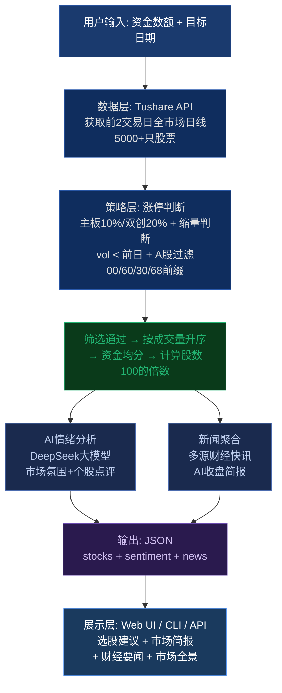

# QuantOrion 缩量连板量化策略 逻辑流程图 Prompt

## 英文版（适用于 DALL-E / Midjourney）

```
A professional technical flowchart diagram showing the QuantOrion quantitative trading system architecture. 
Dark navy blue background (#0F2447) with silver gray borders (#E8EDF5) and green accent highlights (#22B573).

The flowchart shows 7 sequential stages connected by downward arrows, arranged vertically:

[TOP BOX] "User Input: Capital Amount + Target Date" - rounded rectangle, dark blue fill, white text

[DOWN ARROW] - thin green line with arrowhead

[BOX] "Data Layer: Tushare API fetches previous 2 trading days of full-market daily data (5000+ stocks)" - rectangle, medium blue fill, labeled as "tushare_client.py"

[DOWN ARROW]

[BOX] "Strategy Layer: Limit-up detection (10%/20% threshold) + Volume decline check + A-share filter (00/60/30/68 prefixes)" - rectangle, labeled as "main.py"

[DOWN ARROW]

[GREEN HIGHLIGHTED BOX] "Candidates pass filter -> Sort by volume ascending -> Equal capital allocation -> Calculate shares (multiple of 100)" - bright green border, white fill

[DOWN ARROW forks into two parallel paths]

[LEFT BOX] "AI Sentiment Analysis: DeepSeek LLM evaluates market mood and individual stock commentary (display only)" - labeled "ai_sentiment.py"
[RIGHT BOX] "News Aggregation: Multi-source financial news + AI-generated daily market brief" - labeled "market_news.py"

[DOWN ARROWS merge back]

[BOX] "Output: JSON response with stocks[], sentiment{}, news[], stock_news{}" - rounded rectangle

[DOWN ARROW]

[BOTTOM BOX] "Display Layer: Web UI / CLI / REST API -> Stock picks + AI market brief + Financial headlines + Market overview dashboard" - wide rounded rectangle, light blue fill

Style: Clean minimalist fintech flowchart, dark mode, precise geometric shapes, no hand-drawn elements, 
professional quantitative trading aesthetic, 16:9 aspect ratio, 4K resolution, 
sans-serif monospace font for code labels, modern data visualization style.
```

## 中文版（适用于国内AI绘图工具）

```
一张专业的量化交易系统逻辑流程图，深色背景（深空蓝#0F2447），银灰色边框，绿色数据高亮。

垂直排列的7个阶段，箭头连接：

顶部方框：「用户输入：资金数额 + 目标日期」圆角矩形，深蓝底白字

向下箭头（绿色细线）

方框：「数据层 Tushare API 获取前2交易日全市场日线数据 5000+只股票」标注 tushare_client.py

向下箭头

方框：「策略层 涨停判断(主板10%/双创20%) + 缩量判断(成交量<前日) + A股过滤(00/60/30/68前缀)」标注 main.py

向下箭头

绿色高亮方框：「筛选通过 → 按成交量升序排列 → 资金均分 → 计算股数(100的倍数)」

向下箭头（分叉为两条并行路径）

左侧方框：「AI情绪分析 DeepSeek大模型 评估市场氛围和个股点评（仅展示）」标注 ai_sentiment.py
右侧方框：「新闻聚合 多源财经快讯 + AI自动生成每日收盘简报」标注 market_news.py

向下箭头（合并）

方框：「输出 JSON格式 stocks[] + sentiment{} + news[]」

向下箭头

底部方框：「展示层 Web界面 / 命令行 / API → 选股建议 + AI市场简报 + 财经要闻 + 市场全景面板」浅蓝底

风格：极简金融科技扁平化设计，精密几何图形，无手绘感，专业量化投研美学，
16:9比例，4K高清，无衬线数字字体，现代数据可视化风格。
```

## 使用说明

1. 复制上述 Prompt 到 DALL-E 3 / Midjourney / 通义万相 / 文心一格
2. 如需更精确的架构图，建议使用 **draw.io** 或 **Excalidraw** 手动绘制
3. 也可配合 Mermaid 语法生成代码级流程图（见下方）

## Mermaid 代码版本（可直接渲染）


